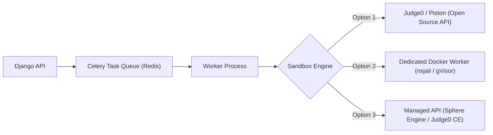
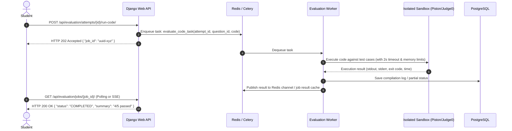

# 02. Tech Stack & Architecture Decisions

> **Objective:** Evaluate current technologies, address framework migration questions (Node vs. FastAPI vs. Django), choose the optimal decoupled frontend framework, and define the production sandboxing and asynchronous architecture.

---

## 1. Backend Stack Evaluation: Keep Django or Migrate?

The user asked:
> *"Is the technical stack good? Is there any requirement to convert it into Node or FastAPI or anything else? Is it a good choice of stack?"*

### 1.1 Comparative Framework Evaluation

| Criteria | Django + Django REST Framework (Current) | FastAPI | Node.js (NestJS / Express) |
| :--- | :--- | :--- | :--- |
| **Relational Data Complexity** | **Exceptional**. Built-in ORM with robust transactions, complex relational modeling, and migration engine. | **Moderate**. Relies on SQLAlchemy 2.0 or Tortoise. Migrations with Alembic are manual and verbose. | **Moderate**. Prisma or TypeORM have migration edge cases with complex relational constraints and cascading rules. |
| **Out-of-the-box Admin Tooling** | **Unmatched**. Django Admin provides an immediate, secure operations portal to inspect attempts, tests, and users. | **None**. Must build custom admin portal or integrate third-party tools (e.g. SQLAdmin). | **Limited**. Admin portals require third-party libraries (e.g. Forest Admin, AdminJS). |
| **Security & Authentication** | **Battle-tested**. Built-in Argon2/PBKDF2 hashers, CSRF, session handling, timing attack defenses. | **Manual**. Developer must wire together OAuth, JWT, and password hashing libraries manually. | **Manual**. Developer must assemble Passport, JWT, Bcrypt, and validation libraries. |
| **Background Task Ecosystem** | **Industry Standard**. Celery + Redis is rock solid for heavy asynchronous grading and email dispatch. | **Good**. Celery or ARQ can be used, but integration requires more glue code. | **Good**. BullMQ + Redis, but running Python code sandbox from Node adds cross-language overhead. |
| **Code Execution Alignment** | **Native**. Sandboxing Python, data structures, and code execution is native in Python. | **Native**. Same Python ecosystem. | **Fragmented**. Spawning and analyzing Python code execution from a Node runtime adds IPC complexity. |
| **Performance for this Domain** | **High**. DRF with PostgreSQL and Redis caching handles tens of thousands of test-takers easily. | **Very High** (raw async I/O). However, database queries remain the primary latency bottleneck. | **Very High** (event loop). But gains are negligible compared to DB and sandbox overhead. |

### 1.2 The Verdict: Retain Django + DRF

**Recommendation: Do NOT convert to Node.js or FastAPI.**

#### Why?
1. **The problem is architecture, not framework performance:** The current performance and security issues (synchronous code execution, N+1 queries, answer leaks) are implementation flaws. Moving to FastAPI or Node without changing the design would simply replicate the exact same bugs in another language.
2. **Relational Depth:** An assessment engine is fundamentally relational:
   $$\text{User} \longleftrightarrow \text{Group} \longleftrightarrow \text{Test} \longleftrightarrow \text{Question} \longleftrightarrow \text{Option / TestCase} \longleftrightarrow \text{Attempt} \longleftrightarrow \text{Response}$$
   Django's transactional integrity (`transaction.atomic()`), relational constraints, and migration tracking are unmatched in developer productivity and reliability.
3. **The Power of Django Admin:** During live examinations, teachers, proctors, and support staff need an immediate dashboard to look up a student's attempt, unlock an auto-submitted test, or view error logs. Rebuilding this in Node or FastAPI would require weeks of extra development.
4. **Python's Native Fit:** Python is the default language for academic testing, AI evaluation, and competitive programming. Running code evaluation natively in the same Python environment streamlines infrastructure.

---

## 2. Frontend Framework Decision: SPA vs. SSR

The user asked:
> *"I think backend should be separated from the frontend... we should build a frontend with Nuxt or React or whatever makes it simple... clean frontend where there will be reusable components and the UI will look clean and maintainable."*

### 2.1 The Core Dilemma: Do We Need SSR (Server-Side Rendering)?

- **What is SSR?** Next.js (React) or Nuxt 3 (Vue) run a Node.js server that renders HTML on the server before sending it to the client. SSR is necessary when public pages need search engine indexing (SEO) or ultra-fast first-contentful-paint on slow mobile connections.
- **What is an Online Assessment Platform?**
  - An authenticated, stateful, desktop-first web application.
  - Every meaningful screen (Dashboard, Test Composer, Exam Hall, Results Paper) requires a valid JWT token and user authentication.
  - Search engine spiders (Googlebot) will **never** index exam questions, student attempts, or test composers behind login walls.

### 2.2 Framework Comparison for Testron V2

| Framework | Architecture | Pros | Cons | Verdict |
| :--- | :--- | :--- | :--- | :--- |
| **React + Vite + Tailwind + shadcn/ui** | **Client-Side SPA** | • Extremely fast build and reload.<br>• Zero server hosting cost (host on Cloudflare Pages, Vercel, or S3/CloudFront for $0).<br>• Huge ecosystem for code editors (Monaco), charts (Recharts), and rich UI (shadcn/ui).<br>• Clean separation from backend. | • Client-side bundle download on initial load (negligible on modern broadband). | **TOP RECOMMENDATION** (Simplicity, speed, maintainability) |
| **Nuxt 3 (Vue 3)** | **SSR / Hybrid or SPA** | • Very clean template syntax.<br>• Built-in file-based routing.<br>• Great developer experience if the team has Vue expertise. | • Adds Node.js server maintenance if deployed in SSR mode.<br>• Monaco Editor and Katex integration require client-only wrappers (`<ClientOnly>`). | **STRONG ALTERNATIVE** (If team prefers Vue/Nuxt syntax) |
| **Next.js 14/15 (React)** | **SSR / React Server Components (RSC)** | • Industry standard for full-stack React.<br>• File-based routing and Server Actions. | • RSC complexity is massive overkill for an authenticated portal.<br>• Complex deployment and hydration mismatches with timers and code editors. | **OVERKILL** (Unnecessary complexity for this use case) |

### 2.3 Frontend Recommendation: React 18/19 + Vite + Tailwind CSS + shadcn/ui

#### Why this choice?
1. **Unbeatable Component Ecosystem:**
   - **Monaco Editor (`@monaco-editor/react`)**: The exact editor powering VS Code for coding questions.
   - **KaTeX (`react-katex`)**: High-performance LaTeX formula rendering for math/physics questions.
   - **shadcn/ui**: Unstyled, accessible, beautifully designed components (Dialogs, Dropdowns, Tabs, Tooltips, Forms) copied directly into your codebase with complete styling control.
   - **TanStack Query (React Query)**: Handles caching, background refetching, and eliminates complex boilerplate fetch code.
2. **Simplified DevOps:**
   - The compiled frontend outputs pure static assets (`dist/index.html`, `assets/*.js`, `assets/*.css`).
   - Can be served from Nginx, Cloudflare Pages, Netlify, or AWS S3 for zero compute cost, completely isolating frontend traffic from backend API performance.
3. **Timer & Proctoring Stability:**
   - An exam hall requires a long-lived, continuous JavaScript execution environment for countdown timers, full-screen triggers, and tab-switch detection. A client-side SPA avoids page-reloading and hydration bugs common in SSR frameworks.

---

## 3. Sandboxed Code Execution Architecture

The V1 implementation of `subprocess.Popen(['python3', '-c', source_code])` on the web container is a critical vulnerability. In V2, code execution must be segregated into a secure, sandboxed environment.

### 3.1 Comparison of Sandboxing Options



| Strategy | Architecture | Security Level | Maintenance Overhead | Suitability for V2 |
| :--- | :--- | :--- | :--- | :--- |
| **Option 1: Self-hosted Judge0 / Piston Container** | Standalone microservice deployed alongside Django via Docker Compose. Handles multi-language isolation out of the box. | **Very High** (cgroups, unshare, chroot, strict resource limits). | **Low to Medium**. Uses standard Docker images; API is well-documented. | **Recommended for Production** |
| **Option 2: Dedicated Isolated Celery Worker with nsjail / gVisor** | Celery worker spawns non-root processes inside Linux namespaces (`nsjail` or Google `gVisor`). | **Maximum**. High control over memory limits, CPU quotas, and syscall filtering. | **Medium**. Requires configuring Linux cgroups and seccomp profiles. | **Recommended if running custom single-container environments** |
| **Option 3: External Managed API** | Offload code execution to commercial APIs (e.g. Judge0 Cloud, Sphere Engine). | **High**. Zero infrastructure management. | **Lowest**. Pure HTTP integration. | **Best if infrastructure budget exists and dev time is tight** |

### 3.2 V2 Execution Flow: Asynchronous Evaluation


---

## 4. Overall V2 System Architecture

```mermaid
graph TB
    subgraph Client Layer
        WebClient["React SPA (Desktop / Tablet)"]
    end

    subgraph Edge & Gateway
        Cloudflare["Cloudflare / CDN (Static Assets & SSL)"]
        Nginx["Reverse Proxy / Nginx"]
    end

    subgraph Application Tier
        DjangoWeb["Django REST Framework (Gunicorn)<br/>• Stateless JSON API<br/>• Session & JWT Auth<br/>• Business Logic Services"]
    end

    subgraph Asynchronous Tier
        Redis["Redis 7<br/>• Celery Broker & Result Store<br/>• Active Exam Timers (TTL)<br/>• Rate Limiting & OTPs"]
        CeleryWorker["Celery Workers<br/>• Code Execution Queue<br/>• Email / OTP Queue<br/>• Batch Score Aggregator"]
        Sandbox["Code Execution Sandbox<br/>• Piston / Judge0 / nsjail<br/>• Ephemeral, Network-Disabled"]
    end

    subgraph Persistence Tier
        Postgres[("PostgreSQL 15+<br/>• Users & RBAC<br/>• Groups & Memberships<br/>• Tests, Questions, Test Cases<br/>• Attempts & Responses")]
        ImageKit["ImageKit Cloud<br/>• Question Images CDN"]
    end

    Client Layer --> Cloudflare
    Cloudflare -->|Static Assets| WebClient
    Cloudflare -->|API Requests| Nginx
    Nginx --> DjangoWeb
    DjangoWeb --> Postgres
    DjangoWeb --> Redis
    DjangoWeb --> ImageKit
    DjangoWeb -->|Async Tasks| Redis
    Redis --> CeleryWorker
    CeleryWorker --> Sandbox
    CeleryWorker --> Postgres
```

