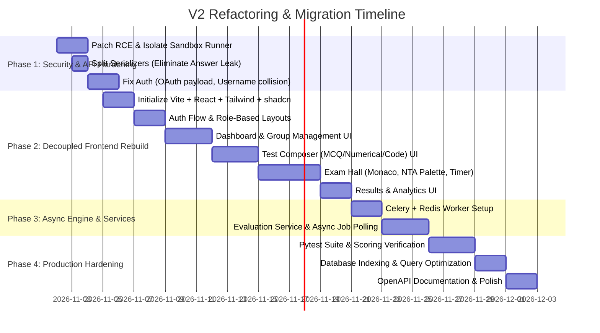

# 03. Refactor Roadmap & Priorities

> **Framework:** Categorization of refactoring initiatives into **Necessary (Must-have)**, **Recommended (Production Standard)**, and **Ideal (Overkill / Future-proofing)**, accompanied by a realistic phased execution schedule.

---

## 1. Prioritization Matrix: Necessary vs. Recommended vs. Overkill

```
                    ▲ HIGH BUSINESS & SECURITY IMPACT
                    │
                    │   [TIER 1: NECESSARY]
                    │   • Fix Subprocess RCE Sandbox
                    │   • Fix Student Answer Leak
                    │   • Decouple Frontend (Vite SPA)
                    │   • Fix Google OAuth HTML Injection
                    │   • Fix Username Collision Bug
                    │
                    │   [TIER 2: RECOMMENDED]
                    │   • Celery + Redis Async Tasks
                    │   • Service Layer Extraction
                    │   • Pytest Test Suite (Scoring)
                    │   • Eliminate N+1 SQL Queries
                    │   • OpenAPI Schema & Types
                    │
                    │   [TIER 3: OVERKILL / AVOID]
                    │   • Microservices Architecture
                    │   • Real-Time WebSockets
                    │   • Kubernetes Cluster Deployment
                    │   • AI Video Proctoring
                    │
  LOW EFFORT ───────┴──────────────────────────────► HIGH EFFORT
```

---

## 2. Detailed Breakdown by Tier

### Tier 1: Necessary (Must-Do Immediately — P0 / P1)
*These items address critical security vulnerabilities, data leaks, fatal bugs, or the foundational separation of frontend and backend.*

| ID | Initiative | Problem in V1 | Solution in V2 |
| :--- | :--- | :--- | :--- |
| **N-01** | **Patch Subprocess RCE** | `subprocess.Popen` runs arbitrary user code directly on the web container as root. | Run code in an isolated non-root container or sandbox engine with strict resource quotas and network disabled. |
| **N-02** | **Eliminate Answer Leak in API** | `TestSerializer` returns `MCQOption.is_correct` and `CodeTestCase.expected_output` to students querying `/api/testing/tests/<id>/`. | Separate into `TeacherTestSerializer` and `StudentTestSerializer` (never expose correct options or hidden test cases). |
| **N-03** | **Decouple Frontend & Backend** | 3,000+ lines of raw HTML templates with inline JavaScript and CSS in Django `templates/`. | Extract into a standalone SPA using **React + Vite + Tailwind CSS** (or Vue/Nuxt). Remove Django template views. |
| **N-04** | **Fix Google OAuth Callback** | `GoogleCallbackView` returns inline HTML `<script>` with `localStorage.setItem` and redirects to `/dashboard/`. | Redirect to frontend callback route with auth exchange token or set secure, HTTP-only cookie. |
| **N-05** | **Fix Username Collision Bug** | Auto-generating `username` from email prefix causes 500 DB integrity crashes when identical email prefixes register. | Remove username dependence; use `email` as `USERNAME_FIELD` or assign a random UUID to `username`. |
| **N-06** | **Fix Runtime Crashes** | Missing `import pytz` in `TestSerializer`; missing `programming_language` field on `Question` model. | Add model fields, run migrations, and clean up timezone imports using standard `django.utils.timezone`. |
| **N-07** | **Secure Cross-Origin Settings** | `CORS_ALLOW_ALL_ORIGINS = True` is hardcoded. | Configure explicit `CORS_ALLOWED_ORIGINS` pointing strictly to the frontend development and production URLs. |

---

### Tier 2: Recommended (Production Standard — P2)
*These items transform a working prototype into an enterprise-grade, maintainable, and scalable application.*

| ID | Initiative | Problem in V1 | Solution in V2 |
| :--- | :--- | :--- | :--- |
| **R-01** | **Implement Celery Async Tasks** | Synchronous code execution and SMTP email sending block Gunicorn workers for up to 50 seconds. | Offload code execution, email dispatch, and heavy report aggregation to Celery workers backed by Redis. |
| **R-02** | **Extract Service Layer** | Fat views mix HTTP handling, scoring algorithms, and database transactions in 140+ line methods. | Create dedicated service modules: `EvaluationService`, `TestScoringService`, `ClassroomService`, `AuthService`. |
| **R-03** | **Declarative DRF Permissions** | Permissions checked via ad-hoc `if` statements inside views; students can create teacher groups. | Create reusable permission classes: `IsTeacher`, `IsStudent`, `IsGroupTeacher`, `HasValidAttempt`. |
| **R-04** | **Eliminate N+1 Database Queries** | Inefficient `obj.memberships.filter().count()` per row and unoptimized analytics loops. | Use `.annotate(member_count=Count(...))` and `select_related` / `prefetch_related`. Add DB indexes on foreign keys. |
| **R-05** | **Automated Testing Suite** | Zero tests exist across the entire project (`tests.py` files are empty). | Implement `pytest-django` covering: scoring math (MCQ partial marks, negative marks, float tolerance), permissions, and timers. |
| **R-06** | **OpenAPI Spec & TypeScript Types** | Frontend developers must inspect Django view code to guess API payload shapes. | Install `drf-spectacular` for automated OpenAPI 3.0 generation and auto-generate TypeScript types via `openapi-typescript`. |
| **R-07** | **Standardized API Error Envelope** | Inconsistent error responses (some return string arrays, some dicts, some HTTP responses). | Standardize response envelopes: `{ success: true, data: {...} }` and `{ success: false, error: { code, message, details } }`. |

---

### Tier 3: Ideal (Overkill / Avoid for Now — P3)
*These ideas often appear in architectural discussions but represent premature optimization or unnecessary complexity for this project stage.*

| ID | Initiative | Why it is an Overkill / Trap | Sensible Alternative |
| :--- | :--- | :--- | :--- |
| **O-01** | **Splitting into Microservices** | Breaking into separate repositories (Auth Service, Group Service, Exam Service, Scoring Service) creates massive network latency, distributed transaction nightmares, and deployment complexity. | **Keep a Modular Monolith**: Maintain Django apps (`users`, `classroom`, `testing`, `evaluation`, `analytics`) with clear internal boundaries. |
| **O-02** | **WebSockets for Live Exam State** | Managing stateful WebSocket connections for thousands of concurrent students introduces connection dropouts, reconnection storms, and sticky session routing issues. | **HTTP Polling + Redis Timers**: Short, cached HTTP polling for question updates and Redis TTL checks is resilient, stateless, and trivial to scale. |
| **O-03** | **Kubernetes (K8s) Cluster** | Deploying a full Kubernetes cluster for an early-stage assessment platform introduces high DevOps overhead, ingress controllers, and steep infrastructure costs. | **Docker Compose / Managed Container PaaS**: Use Render, Railway, or AWS ECS with separate Web and Worker services. |
| **O-04** | **AI/Webcam Video Proctoring** | Implementing client-side computer vision (face tracking, multiple people detection, gaze estimation) causes false positives, high client CPU usage, and privacy/GDPR compliance hurdles. | **Focus on Reliable Browser Proctoring**: Tab-switch detection (`visibilitychange`), full-screen enforcement, clipboard locking, and server-side timing validation. |

---

## 3. Phased Refactor Execution Schedule



### Phase 1: Security & API Hardening (Days 1–5)
- **Goal:** Neutralize severe vulnerabilities while keeping existing endpoints operational.
- **Deliverables:**
  1. Replace direct host `subprocess` with a sandboxed execution wrapper.
  2. Implement `StudentQuestionSerializer` and restrict `TestViewSet` so students cannot inspect correct answers.
  3. Update `GoogleCallbackView` to redirect to a frontend URL with query params or set an HTTP-only auth cookie.
  4. Fix `User` model username generation to avoid integrity collisions.
  5. Configure strict CORS and secure settings.

### Phase 2: Decoupled Frontend Foundation & Rebuild (Days 6–18)
- **Goal:** Replace the 5 monolithic Django HTML templates with a clean, modern SPA.
- **Deliverables:**
  1. Scaffold `frontend/` with React, Vite, Tailwind CSS, shadcn/ui, and TanStack Query.
  2. Implement centralized Auth Provider (JWT in memory / HTTP-only cookie, auto-refresh on 401).
  3. Build responsive, reusable components (Card, Dialog, Table, Badge, Button, Input, Dropdown).
  4. Build Teacher & Student Dashboards.
  5. Build Test Composer with dynamic question builder, KaTeX preview, and ImageKit upload.
  6. Build Exam Hall with Monaco Editor, NTA status palette, fullscreen enforcement, and tab-switch proctoring.
  7. Build Results Paper and Performance Analytics screens.

### Phase 3: Service Layer & Background Workers (Days 19–24)
- **Goal:** Eliminate synchronous bottlenecks and decouple domain logic from HTTP views.
- **Deliverables:**
  1. Setup Celery worker with Redis broker in `docker-compose.yaml`.
  2. Offload OTP email sending to `send_otp_email_task`.
  3. Extract evaluation logic into `EvaluationService.evaluate_submission(...)`.
  4. Implement async code evaluation job queue (`POST /run-code/` -> 202 Accepted -> `GET /jobs/{id}/`).

### Phase 4: Automated Testing & Production Hardening (Days 25–30)
- **Goal:** Verify reliability, data integrity, and performance under exam loads.
- **Deliverables:**
  1. Write unit tests for NTA marking logic (positive marks, negative marks, partial marks, numerical floating tolerance).
  2. Write integration tests for attempt lifecycle (start, submit answer, tab violation, auto-submit on timeout).
  3. Optimize queries with `select_related`, `prefetch_related`, and database indexes.
  4. Generate OpenAPI 3.0 spec via `drf-spectacular` and build deployment documentation.

