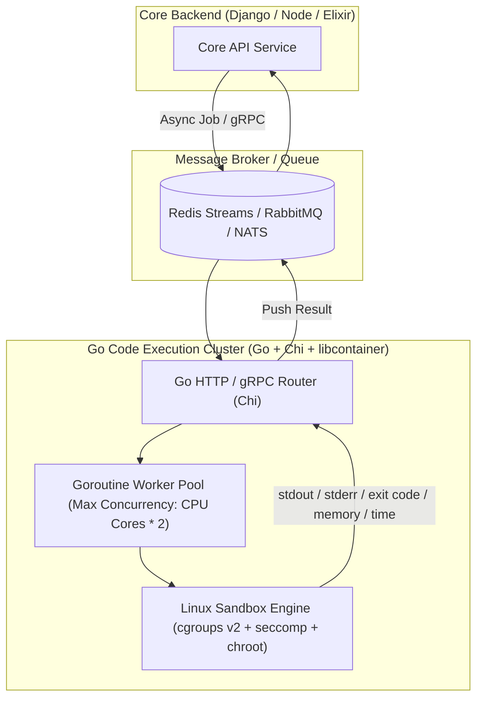

# 06. Advanced Scaling & Architectural Explorations

> **Context:** An exploratory architectural document examining high-scale, enterprise-grade decisions for **Testron** when designed to scale to hundreds of thousands of concurrent examinees. Explores microservices, a dedicated Go code runner, Elixir/Phoenix WebSockets, Nuxt 3 + Nitro as an API Gateway, Keycloak IAM, and "Greenfield" framework rankings.

---

## 1. High-Concurrency Code Execution: Dedicated Go (Chi) Microservice

### 1.1 Why Go for the Code Execution Sandbox?
In an online assessment, code execution is the most resource-intensive and latency-sensitive workload. When 500 students in an exam hall hit "Run Code" simultaneously:
- **Python / Django:** Spawning threads or processes in Python incurs heavy memory overhead (~30–50MB per worker) and GIL constraints.
- **Go (Golang):**
  - **Goroutines:** Ultra-lightweight (~2KB initial stack size). A Go service can manage 10,000+ concurrent worker requests with negligible memory consumption.
  - **Native Linux System Calls:** Go has native access to `syscall` and `golang.org/x/sys/unix`. It can directly manipulate Linux `cgroups` (v2), namespaces (`CLONE_NEWPID`, `CLONE_NEWNET`, `CLONE_NEWNS`), and `seccomp` filters without relying on heavy external wrappers.
  - **Zero-Dependency Single Binary:** Compiles into a tiny, scratch-based container (~15MB), drastically reducing attack surfaces.

### 1.2 Go + Chi Architecture for Sandbox Runner



### 1.3 Key Features of a Dedicated Go Sandbox
1. **Network Namespace Isolation:** Instantly disconnects untrusted code from all network interfaces (`CLONE_NEWNET`), preventing data exfiltration or internal port probing.
2. **Hard Cgroup Quotas:** Enforces strict memory caps (e.g., 128MB limit via `memory.max`) and CPU time slices (e.g., 2 CPU seconds via `cpu.max`), terminating fork bombs (`pids.max = 20`) automatically at the kernel level.
3. **Communication Protocol:** For high throughput, communicate via **gRPC (HTTP/2 Protocol Buffers)** instead of raw JSON over HTTP. gRPC eliminates serialization bottlenecks and allows multiplexed streaming of terminal outputs.

---

## 2. Real-Time Room & Proctoring: Elixir / Phoenix vs. Node.js vs. Go

The user proposed: *"if we are using websockets for the room connections, should we not use phoenix or node or go? (phoenix is my personal choice...)"*

### 2.1 The Verdict on Phoenix (Elixir)
**Your intuition is exceptionally sharp.** For real-time room connections, presence tracking, and exam hall state synchronization, **Phoenix (running on the Erlang BEAM VM) is the gold standard of the software industry.**

#### Why Phoenix / BEAM Outclasses Node and Go for WebSockets:
1. **Actor Model (BEAM Processes):** Each WebSocket connection in Phoenix runs as an isolated, lightweight Erlang process (~1–2KB memory). 2 million concurrent connections can run on a single commodity server (demonstrated repeatedly by Discord and the Phoenix team).
2. **Supervision Trees & Fault Tolerance ("Let it Crash"):** If one student's connection drops, throws a malformed payload, or experiences an uncaught exception, **only that single micro-process terminates**. It cannot crash the server, leak memory, or degrade other students' sessions.
3. **Phoenix Channels & Presence:** Phoenix has a built-in CRDT (Conflict-free Replicated Data Type) based **Presence system**. It effortlessly tracks who is in the exam room, who switched tabs, and who disconnected across distributed server nodes without hammering a central database or Redis.

### 2.2 Framework Comparison for Real-Time Exam Rooms

| Metric | Phoenix (Elixir) | Go (e.g., Gorilla / Melody) | Node.js (Socket.io / ws) |
| :--- | :--- | :--- | :--- |
| **Concurrency Model** | Preemptive Actor Model (BEAM processes). | Cooperative Goroutines. | Single-threaded Event Loop. |
| **Fault Isolation** | **Total.** One crash never affects another connection. | **Moderate.** Unhandled panic in goroutine can crash the binary. | **Poor.** Uncaught exception can crash the entire Node process. |
| **Built-in Presence / PubSub** | **Native** (Phoenix Channels + Presence CRDTs). | Requires custom Redis PubSub or library. | Requires Redis adapter (`@socket.io/redis-adapter`). |
| **Developer Velocity** | High once Elixir syntax is learned; Elixir is very clean. | High if familiar with Go; manual channel multiplexing. | Fastest initial ramp-up, but hardest to scale reliably. |
| **Verdict** | **Clear Winner for Real-Time Rooms.** | **Second Best** (great raw performance). | **Sufficient for V1, Weak for Massive Scale.** |

---

## 3. Frontend Selection: Nuxt 3 (Vue) vs. React (Vite / Next.js)

The user asked:
> *"i think i would like to go for nuxt... it comes with a lotttt of prebuilt components... tell me why go for react and why not nuxt... since it comes with a nitro server, we can also use it as a forwarding proxy and it would help us handle multiple services if we split it into some microservices."*

### 3.1 The Truth About Nuxt 3 & Prebuilt Components
- **Clarification:** Nuxt 3 itself is an application framework (like Next.js). It does **not** ship with hundreds of UI components out of the box by default; rather, the Vue/Nuxt ecosystem has libraries like **Nuxt UI** (built on Tailwind & Radix/Headless UI), **Vuetify**, and **PrimeVue**.
- **Nuxt UI** is phenomenal: it provides buttons, modals, notifications, tables, and forms with zero configuration, often feeling much more integrated than assembling React libraries manually.

### 3.2 Nitro Engine as an API Gateway / BFF (Backend-For-Frontend)
Nuxt 3 runs on **Nitro**, an ultrafast universal server engine. Nitro can act as a **Reverse Proxy / Forwarding Layer**:
```typescript
// server/api/[...].ts (Nuxt 3 Nitro Proxy)
export default defineEventHandler(async (event) => {
  const target = event.path.startsWith('/api/code')
    ? 'http://go-code-runner:8080'
    : event.path.startsWith('/api/realtime')
    ? 'http://phoenix-rooms:4000'
    : 'http://django-backend:8000';

  return proxyRequest(event, `${target}${event.path}`);
});
```
**Advantage:** The browser communicates exclusively with one domain (`testron.app`). Nitro transparently routes code execution to Go, room WebSockets to Phoenix, and exam records to Django/Node without CORS friction or exposing internal service ports.

### 3.3 Nuxt 3 vs. React Decision Checklist

Use this checklist to choose the definitive winner for your team:

| Check / Requirement | Nuxt 3 (Vue 3) Winner? | React (Vite / Next) Winner? | Overhead & Trade-off Analysis |
| :--- | :---: | :---: | :--- |
| **1. Integrated UI Velocity (Prebuilt UI)** | **WINNER (Nuxt UI / PrimeVue)** | | Nuxt UI + PrimeVue provide complete, cohesive components out of the box with cleaner template syntax (`v-model`, directives). React often requires assembling shadcn/ui primitives. |
| **2. Code Editor Ecosystem (Monaco / VS Code)** | | **WINNER (React)** | `@monaco-editor/react` is the official standard, mature and robust. In Nuxt 3, Monaco must be wrapped in `<ClientOnly>` to avoid server-side rendering crashes (`window is not defined`). |
| **3. Complex Math / Formula Rendering (KaTeX)** | TIE | TIE | Both have lightweight KaTeX wrappers (`vue-katex` vs `react-katex`). Performance is identical. |
| **4. Nitro Proxy / BFF Capability** | **WINNER (Nuxt 3)** | | Nitro's `proxyRequest` provides a built-in reverse proxy and API Gateway without needing an extra Nginx or Kong instance in local development. |
| **5. Exam State & Timer Hydration** | | **WINNER (React Vite SPA)** | In Nuxt SSR, timers must be carefully mounted inside `onMounted()` to avoid hydration mismatch warnings between server render time and client clock time. In pure React Vite SPA, hydration is non-existent. |
| **6. Developer Talent Pool** | | **WINNER (React)** | React has a significantly larger hiring pool and third-party library availability globally. |

### 3.4 Summary Recommendation for Frontend:
If you enjoy **Nuxt 3**, **go with Nuxt 3!** It is an outstanding framework.  
**How to use it cleanly for Testron:**
- Set `ssr: false` in `nuxt.config.ts` for the `/exam-hall/**` route to avoid timer/Monaco hydration issues, while keeping SSR enabled for landing pages and marketing.
- Utilize **Nitro Server Routes** as your internal API proxy to route requests across multiple microservices.

---

## 4. Rebuilding in Node.js: Can Keycloak Replace Django's Security?

The user asked:
> *"if it is rewritten in node, can we use keycloak to compensate for the built in battle tested django security you told me in the docs that we would miss out on?"*

### 4.1 Can Keycloak Compensate for Django's Auth/Security?
**Yes, and in fact, it exceeds Django's built-in authentication capabilities.**
Keycloak is an enterprise-grade Identity and Access Management (IAM) solution maintained by Red Hat.

#### What Keycloak Gives You:
- **Centralized OAuth 2.0 & OpenID Connect (OIDC):** Single Sign-On (SSO) with Google, Microsoft, GitHub, SAML, and custom LDAP/Active Directory.
- **Advanced RBAC & Fine-Grained Authorization:** Role hierarchies (e.g. Teacher, Head of Department, Student, Proctor) managed via visual console.
- **Enterprise Security Features:** Built-in Multi-Factor Authentication (MFA / TOTP), brute-force detection, token blacklisting, session revocation, and password policies.
- **Stateless Verification:** Node.js services verify incoming JWTs offline via Keycloak's public JWKS (JSON Web Key Set), making auth verification instantaneous across all microservices without DB lookups.

#### The Real Overheads & Trade-offs of Keycloak:
1. **Resource Heavy (Java/JVM):** Keycloak requires a minimum of **1GB to 2GB of RAM** just to run idle. In small cloud instances (e.g. 512MB Render or free tiers), Keycloak will crash with Out Of Memory (OOM) errors.
2. **Operational Complexity:** Managing Keycloak upgrades, theme customization, realm exports, and its dedicated Postgres database adds serious DevOps overhead.
3. **Alternative Lightweight IAMs:** If Keycloak is too heavy, modern lightweight alternatives exist:
   - **Ory Kratos / Hydra:** Written in Go, uses ~20MB RAM, extremely fast.
   - **Auth0 / Clerk / Supabase Auth:** Managed cloud auth (zero DevOps, but cost scales with monthly active users).

---

## 5. Greenfield Rebuild: Which Framework if Starting from Zero?

The user asked:
> *"if we are rebuilding it from zero, which framework would you go for... from the pov of both developer experience (ease and smoothness) and from the pov of what the product requires or is best suited for the use case."*

### 5.1 The Two Perspectives

#### Perspective A: Developer Experience (DX), Velocity & Smoothness
*Focus: How fast can a single developer or small team build reliable features without getting bogged down in boilerplate?*
- **Winner: Django + DRF or NestJS (Node/TypeScript)**
  - Everything is cohesive. Schema migrations, database modeling, validation, and administrative backends are established in hours, not weeks.

#### Perspective B: The Ideal Product Architecture (Concurrency, Scale, Reliability)
*Focus: What architecture naturally survives 100,000 concurrent students taking high-stakes competitive exams?*
- A monolithic Node or Django app struggles when CPU-heavy sandboxing, real-time presence tracking, and relational gradebooks share the same runtime.

---

### 5.2 The Ideal "Dream Stack" for High-Scale Testron V3

If building the ultimate, production-grade assessment platform from zero to scale to 500,000 students, the ideal multi-service architecture partitions responsibilities by their runtime strengths:

```
┌────────────────────────────────────────────────────────────────────────┐
│                        FRONTEND: Nuxt 3 (Vue 3)                        │
│   • Nuxt UI / Tailwind for beautiful, rapid UI components              │
│   • Nitro Engine acting as the Unified API Gateway / Reverse Proxy     │
└───────────────────────────────────┬────────────────────────────────────┘
                                    │
                                    ▼
┌────────────────────────────────────────────────────────────────────────┐
│                      REVERSE PROXY / ROUTING                           │
└──────────────┬────────────────────┼────────────────────┬───────────────┘
               │                    │                    │
               ▼                    ▼                    ▼
     ┌──────────────────┐ ┌──────────────────┐ ┌──────────────────┐
     │  CORE RELATIONAL │ │   REAL-TIME ROOM │ │  CODE EXECUTION  │
     │      SERVICE     │ │     & PROCTOR    │ │      SANDBOX     │
     │                  │ │                  │ │                  │
     │  Django (DRF) or │ │  Elixir/Phoenix  │ │    Go (Chi +     │
     │  NestJS (Node)   │ │     Channels     │ │     cgroups)     │
     └─────────┬────────┘ └─────────┬────────┘ └─────────┬────────┘
               │                    │                    │
               ▼                    ▼                    ▼
     ┌──────────────────┐ ┌──────────────────┐ ┌──────────────────┐
     │  PostgreSQL 16   │ │   Redis Cluster  │ │ Ephemeral Linux  │
     │ (Relational Data)│ │ (Presence/Timers)│ │   Containers     │
     └──────────────────┘ └──────────────────┘ └──────────────────┘
```

#### Breakdown of Roles:
1. **Core Relational Service (Django or Node NestJS):**
   - **Role:** User profiles, groups, test questions, grading rubrics, paper generation, and final score history.
   - **Why:** Relational data and transactional integrity are paramount here. Django's ORM or NestJS with Prisma/TypeORM provides high DX and fast business-logic iterations.
2. **Real-Time Room & Proctoring Service (Elixir / Phoenix):**
   - **Role:** Live exam rooms, heartbeat monitoring, tab-switch tracking, countdown timer synchronization, and instant proctor broadcasts.
   - **Why:** Phoenix Channels effortlessly maintain 100k+ concurrent WebSockets with millisecond latency and zero crash contagion.
3. **Code Execution Sandbox Service (Go + Chi):**
   - **Role:** Receiving submitted code, spawning isolated Linux namespaces (`cgroups` + `seccomp`), running test cases, and returning execution time/memory metrics.
   - **Why:** Go's low-overhead goroutines and native Linux syscalls run sandboxes with maximum safety and zero runtime bloat.
4. **Identity & Access Management:**
   - Either **Django's native auth / SimpleJWT** for zero extra infrastructure, or **Ory Kratos / Keycloak** if migrating to a pure polyglot microservices setup.

