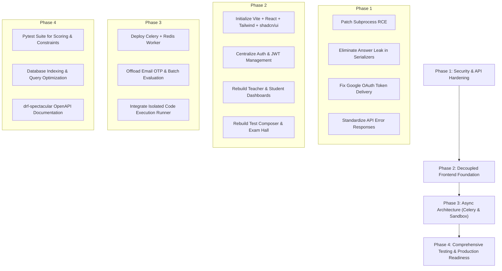

# V2 Architecture, Code Review & Migration Blueprint

> **Project:** Online Assessment Platform (Testron)  
> **Status:** Current State: V1 Prototype | Target State: V2 Production-Grade Decoupled Architecture  
> **Document Date:** November 2026  

---

## 📌 Executive Summary

An exhaustive architectural audit and code review was conducted on the **Online Assessment Platform**. 

The current codebase is a **functional prototype (V1)**. It succeeds in establishing end-to-end functionality—supporting role-based portals, group management, question creation (MCQ, Numerical, Code), live timed attempts, tab-switch proctoring, and scoring analytics.

However, the application is **not yet production-grade or industry-standard**. It exhibits critical architectural anti-patterns, urgent security vulnerabilities (including Remote Code Execution and answer disclosure), synchronous bottlenecks that threaten platform stability during concurrent exams, and an unmaintainable frontend composed of monolithic HTML templates containing inline vanilla JavaScript and CSS.

### Key Conclusions at a Glance:
1. **Backend Tech Stack (Keep Django + DRF):**  
   Converting to Node.js or FastAPI is **unnecessary and ill-advised**. Django + DRF is an ideal choice for this domain due to its robust relational data integrity, migration engine, battle-tested security controls, and built-in administrative tooling. The issues in the codebase are implementation and architectural flaws, not framework limitations.
2. **Frontend Decoupling (Mandatory):**  
   The application currently serves raw HTML files from Django (`templates/*.html`) with inline scripts manually updating the DOM. This must be immediately extracted into a dedicated **Modern Single Page Application (SPA)** using **React + Vite + Tailwind CSS + shadcn/ui** (or **Vue 3 + Vite / Nuxt 3**). Because this is an authenticated portal with zero SEO requirements, a lightweight Vite SPA provides maximum developer velocity, zero server-side rendering complexity, and minimal hosting overhead.
3. **Critical Security Remediation (Immediate P0):**  
   - **Remote Code Execution (RCE):** Coding questions currently execute code via `subprocess.Popen` directly on the host container as `root`. This must be isolated immediately into an ephemeral sandbox runner (Judge0, Piston, or an isolated non-root container).
   - **Answer Leak in API:** The `TestSerializer` exposes `MCQOption.is_correct` and `CodeTestCase.expected_output` to students querying `/api/testing/tests/<id>/`. This must be split into distinct teacher and student serializers.

---

## 📚 V2 Documentation Index

Detailed findings, architectural decisions, and refactoring blueprints have been organized into the following specialized documents:

| Document | Topic | Description |
| :--- | :--- | :--- |
| [**01. Codebase Audit & Review**](./01_codebase_audit_and_review.md) | Audit & Backend First Principles | In-depth code review, security vulnerabilities, N+1 query analysis, domain anti-patterns, and maturity scorecard. |
| [**02. Tech Stack & Architecture Decisions**](./02_tech_stack_and_architecture_decisions.md) | Technical Stack & Sandboxing | Django vs. FastAPI vs. Node.js evaluation, SPA vs. SSR trade-offs, and code execution sandboxing strategies. |
| [**03. Refactor Roadmap & Priorities**](./03_refactor_roadmap_priorities.md) | Prioritization Framework | Categorized tasks across **Necessary (Must-have)**, **Recommended**, and **Ideal (Overkill)** with phased execution milestones. |
| [**04. Backend Redesign & API Specification**](./04_backend_redesign_and_api_spec.md) | Backend Architecture & API Spec | Target folder structure, Service Layer pattern, DRF custom permissions, Celery async processing, and standardized API contracts. |
| [**05. Frontend Architecture Plan**](./05_frontend_architecture_plan.md) | Frontend System Design | Target component hierarchy, state management, Exam Hall timer/proctoring resilience, and Test Composer state machine. |

---

## 🚀 Recommended Refactor Sequence

